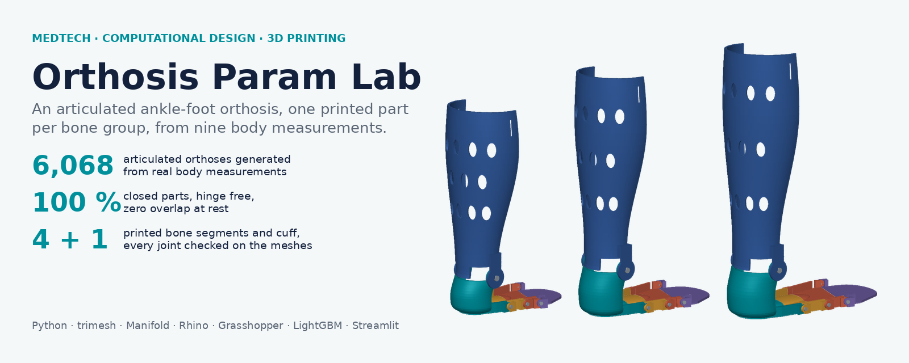
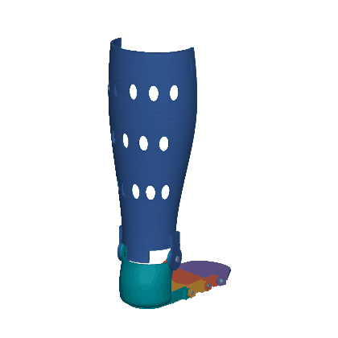
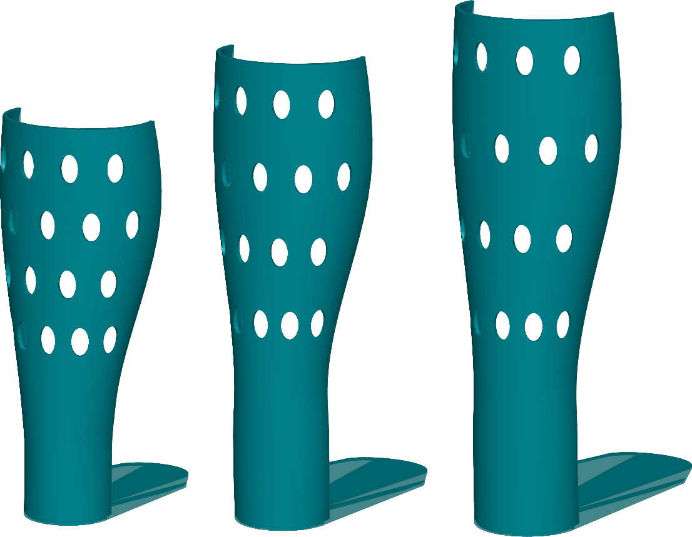
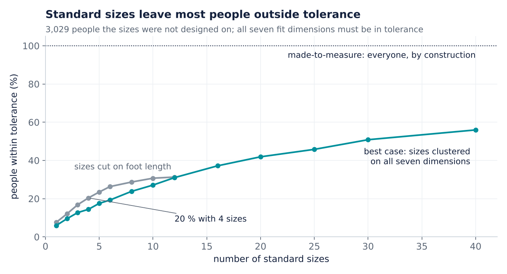
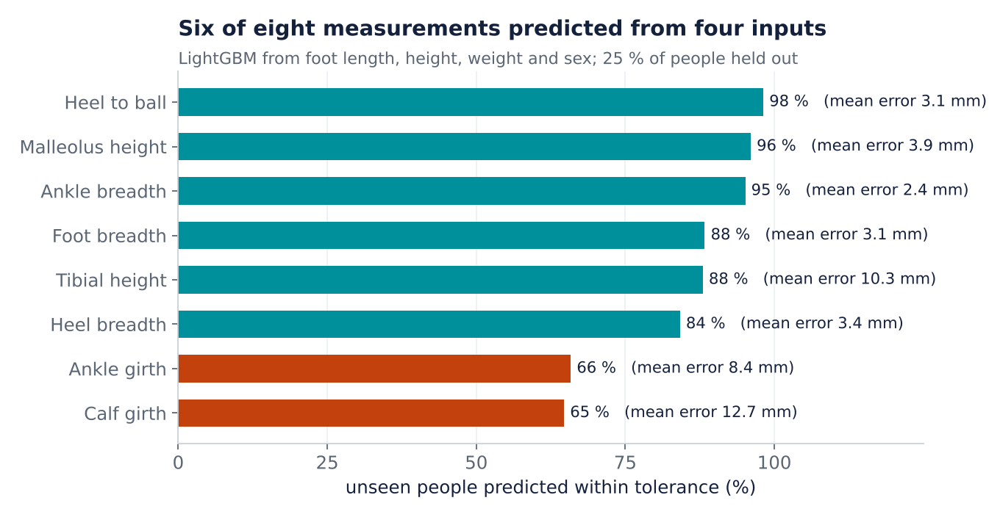
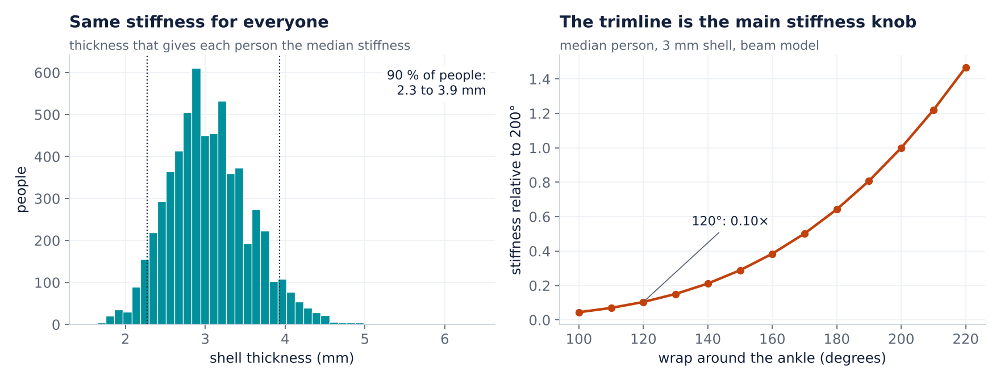
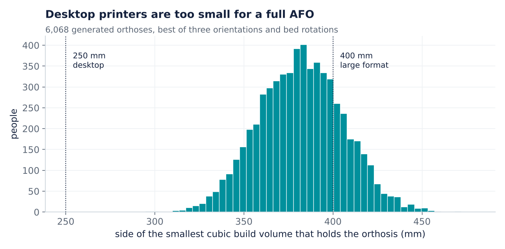
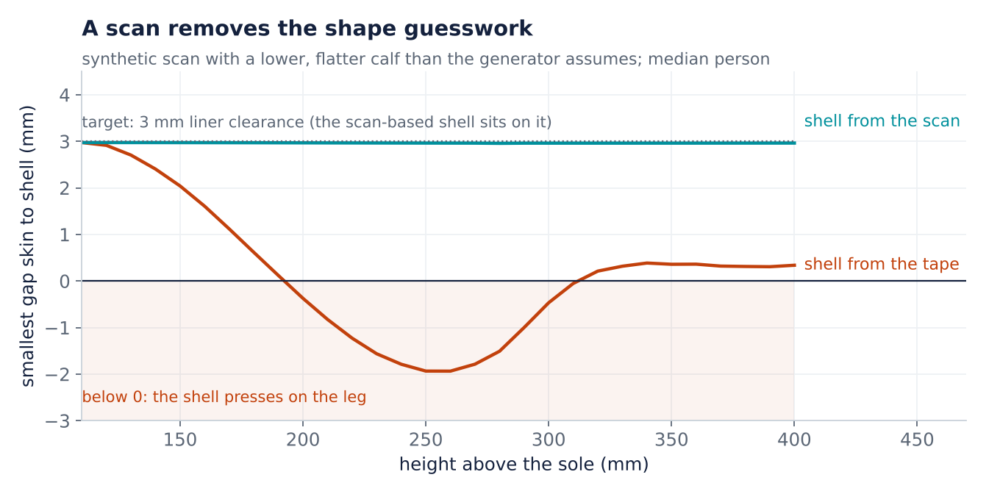
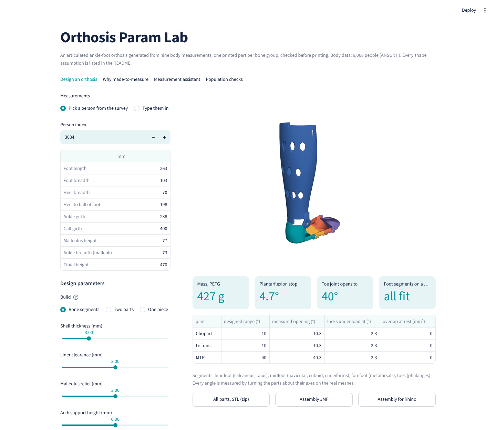
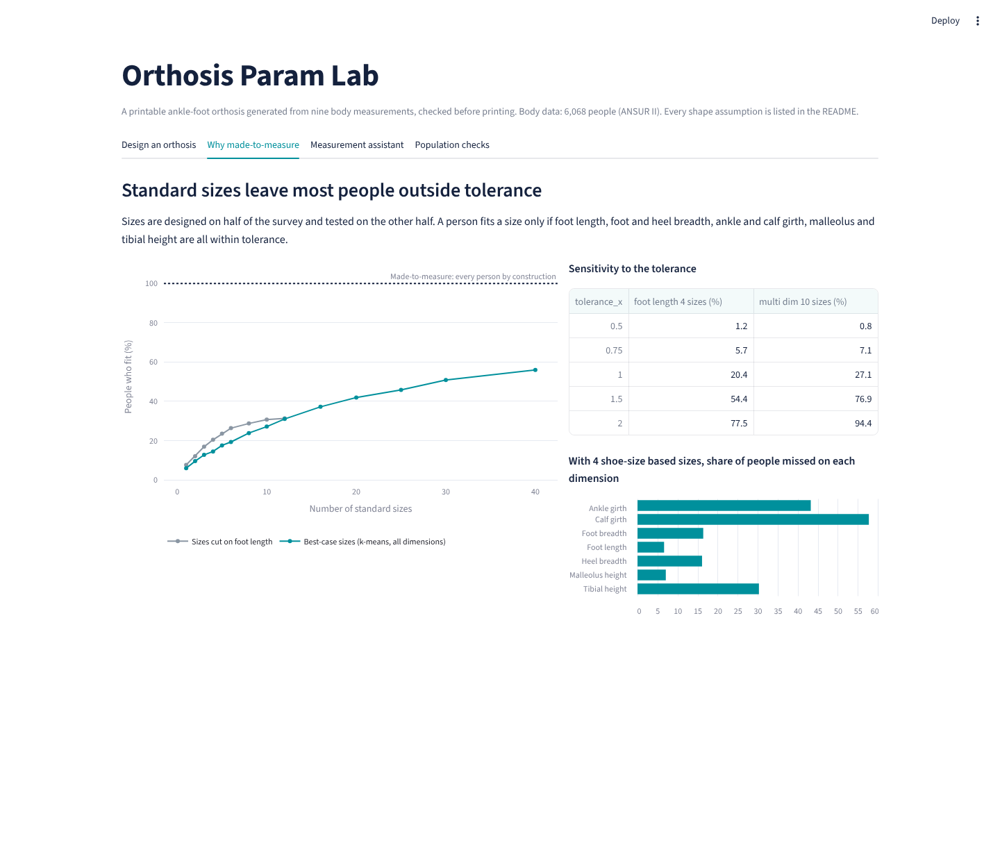

<p align="center"></p>

<p align="center">
<a href="https://github.com/Abderrahmane-BOULAMI/orthosis-param-lab/actions"></a>


</p>

**A joint project by [Abderrahmane BOULAMI](https://github.com/Abderrahmane-BOULAMI) and [Kawtar BELLAMINE](https://github.com/kawtar-bellamine), engineering students at Arts et Métiers ParisTech.**

Custom orthoses are made one person at a time. This lab asks three practical questions a MedTech team meets every day,
and answers them with code that runs on real body measurements:

1. **Can a printable ankle-foot orthosis (AFO) be generated from a handful of tape measurements?** Yes: nine measurements in, a closed solid out, checked for wall thickness, orientation and build volume, exported as STL, 3MF and a Rhino `.3dm` file.
2. **Is made-to-measure worth it, compared with standard sizes?** On 6,068 real people, four shoe-size based sizes fit only **20 %** of them within tolerance.
3. **What still needs the tape, and what can a model fill in?** Lengths can be predicted from foot length, height and weight; **ankle and calf girths cannot**, so they must be measured or scanned.

<p align="center"></p>

## Results at a glance

| Question | Result on 6,068 people (ANSUR II) |
|---|---|
| Orthoses generated, closed and printable | **6,068 / 6,068** watertight (100 %), median **73 ms** each |
| Stress test: extreme bodies × 5 design variants | 75 parts, 100 % watertight, measured wall ≥ 97 % of target (5th percentile) |
| Mass in PETG, 100 % infill (5th to 95th percentile) | 309 to 447 g |
| Smallest cubic printer that holds the part | median 382 mm, 95th percentile 421 mm; **0 %** fit a 250 × 210 × 220 mm desktop printer, **77 %** fit a 400 mm cube |
| People within tolerance with 4 foot-length sizes | **20 %** (12 sizes: 31 %; 40 best-case multi-dimension sizes: 56 %) |
| Main reasons a standard size misses (4 sizes) | calf girth 58 %, ankle girth 43 %, tibial height 30 % of people |
| Ankle stiffness spread at a constant 3 mm shell | 95th / 5th percentile = **1.8×** |
| Thickness that gives everyone the median stiffness | **2.3 to 3.9 mm** (5th to 95th percentile) |
| Ankle trimline 120° instead of 200° | **0.10×** the stiffness (beam model) |
| Unseen people predicted within tolerance (LightGBM) | malleolus height 96 %, heel breadth 84 %, **ankle girth 66 %, calf girth 65 %** |
| Every predicted dimension in tolerance | quick inputs only 31 %; after taping ankle and calf 65 % |
| Fit on a leg whose calf differs from the shape assumptions (synthetic scan) | from the tape: shell presses up to **1.9 mm** into the leg at 11 % of points; from the scan: gap 2.96 to 3.05 mm for a 3 mm target |

<p align="center"></p>
<p align="center"><sub>Same generator, three people from the survey (small, median, large), rendered at the same scale.</sub></p>

## How it works

```
9 measurements ──► limb profile ──► shell + footplate ──► Manifold union ──► checks ──► STL · 3MF · .3dm
 (tape or scan)    elliptical       exact normal           vents cut          watertight, wall,
                   sections, PCHIP  offset, wrap angle     (optional)         orientation, bed fit, mass
```

* **Geometry** (`ortholab/geometry.py`). The leg is a stack of ellipses set by measured girths and breadths
  (perimeter inverted with Ramanujan's formula). The shell is the exact normal offset of each ellipse from the
  liner clearance to clearance + thickness, so the wall is the thickness you ask for. A footplate built from heel
  breadth, ball-of-foot position and foot breadth is fused to it with Manifold booleans.
* **Parameters** (`ortholab/config.py`): thickness, clearance, wrap angle, ankle trimline, ventilation rows,
  plate length. Every height ANSUR does not measure is a named assumption (see [design notes](docs/design_notes.md)).
* **Printability** (`ortholab/printability.py`): watertight and positive volume, wall thickness by ray casting,
  three orientations with bed rotation, support area above 45°, smallest cubic build volume, mass.
* **Stiffness** (`ortholab/mechanics.py`): second moment of area of the exact ankle cross-section (Green's
  theorem), used to rank designs and to solve the thickness that equalises stiffness across people.
* **Scan input** (`ortholab/scan.py`): slices a leg scan every 8 mm and replaces the assumed ellipses above the
  ankle with the measured widths, depths and girths; `fit_gaps` then measures the skin-to-shell gap on the real meshes.
* **Batch command** (`ortholab/cli.py`): a table of patients in, one STL, 3MF, `.3dm` and JSON per patient out,
  plus a check report; the exit code fails the batch if a part is not printable.
* **Rhino and Grasshopper**: `.3dm` files are written with `rhino3dm`, with every measurement and parameter stored
  as user text on the object. `grasshopper/afo_component.py` is a Rhino 8 Python component that calls the same
  generator and outputs a Rhino mesh; it is tested outside Rhino with `rhino3dm` standing in for `Rhino.Geometry`.

## Why made-to-measure

<p align="center"></p>

Sizes are designed on one half of the survey and judged on the other half (3,029 people).
A person fits only if foot length, foot and heel breadth, ankle and calf girth, malleolus and tibial height are all
within tolerance. Even 40 sizes clustered on all seven dimensions leave most people out. The tolerances are
assumptions, so `results/sizing_tolerance.csv` reports coverage from half to twice their values.

## What the tape is still for

<p align="center"></p>

Four models (median by sex, linear regression, a small neural network, LightGBM) predict eight measurements from
foot length, height, weight and sex, trained on 75 % of people and tested on the 25 % they never saw. The three learned
models agree within three points, so the limit is the information, not the algorithm: lengths are predictable (mean error 3.9 mm for malleolus height), girths are not
(8.4 mm ankle, 12.7 mm calf). A clinic can save time on lengths, not on girths.

## Stiffness and trimline

<p align="center"></p>

With the same 3 mm shell for everyone, ankle stiffness varies 1.8× between the 5th and 95th
percentile, because it follows the size of the ankle. The trimline matters even more: cutting the shell from 200° to 120° around the ankle
leaves about a tenth of the stiffness, which is how a rigid AFO becomes a flexible leaf spring.

## Printing

<p align="center"></p>

A full-height AFO does not fit a common desktop printer in any orientation. Lying it on its back trades height for
support material; the code reports both, so the choice is explicit.

## Scan-ready

<p align="center"></p>

Nine tape measurements fix the girths, not where the calf is or how flat it is. Here the leg (a synthetic scan built for
the test) has its calf lower and flatter than the generator assumes. The shell made from the tape presses up to
1.9 mm into the calf; the shell made from the scan keeps the 3 mm liner clearance everywhere it was
measured. The heel and malleoli still come from the tape, because foot scans are noisy there.

```python
from ortholab import geometry, scan
prof = scan.profile_from_scan(leg_scan_mesh, measures)          # scan in mm, z up from the sole
afo = geometry.build_afo(measures, profile=prof)
gaps = scan.fit_gaps(afo, leg_scan_mesh, heights=range(110, 400, 10), thickness=3.0)
```

## Batch production

```bash
python -m ortholab.cli template patients.csv                  # example table: id + nine measurements
python -m ortholab.cli batch patients.csv --out outputs/batch --vent-rows 4
```

Each patient gets `afo_<id>.stl`, `.3mf`, `.3dm` and `.json`; `report.csv` lists watertightness, wall thickness
(5th percentile of ray samples), mass, smallest printer cube, best orientation, support area and ankle stiffness.
Measurements outside the survey range raise a warning, and the command exits with code 1 if any part fails, for
example a wall under the 2 mm minimum.

## Grasshopper

Paste `grasshopper/afo_component.py` into a Rhino 8 Python 3 component, add the inputs listed at the top of the file
(`repo`, `measures`, `thickness`, `clearance`, `ankle_wrap`, `vent_rows`) and the `afo` and `report` outputs. The
first run installs the Python packages through the `# r:` line. This is the bridge to a Grasshopper definition; it has
been run outside Rhino only.

## Dashboard

```bash
pip install -r requirements.txt
streamlit run app/dashboard.py
```

Design an orthosis from a survey person or your own measurements, move the sliders, see the checks update and download
STL, 3MF or `.3dm`. The other tabs show the sizing study, the measurement assistant and the population checks.

| Design | Sizing |
|---|---|
|  |  |

## Reproduce

```bash
python experiments/run_all.py --sample   # 300-person extract shipped in the repo, about a minute
python experiments/run_all.py            # all 6,068 people: downloads ANSUR II once, checks SHA-256
pytest                                   # geometry, thickness, stiffness, scan, batch, Grasshopper, dashboard
python tools/figures.py && python tools/banner.py
```

Data: ANSUR II public working databases (US Army anthropometric survey, 2012; original at
[openlab.psu.edu/ansur2](https://www.openlab.psu.edu/ansur2/)), pulled from a GitHub mirror pinned to one commit and
verified by SHA-256 (`ortholab/config.py`). Lengths in mm.

## Limits

* **No physical prototype yet.** Every result here is computed. The [bench test protocol](docs/test_protocol.md) says
  what to print and measure first, and what result would prove the model wrong.
* **Shape from measurements by default.** Ellipses capture girths and breadths, not bony landmarks or the arch. Some
  heights (minimum ankle girth, calf girth, below-knee girth) are assumptions listed in the design notes. The scan
  input removes them for the leg, but it has only been tested on synthetic scans; a real scan first needs cleaning
  and alignment to the sole, heel-back frame.
* **Stiffness is a beam model.** It ranks designs and people; it is not FEA and gives no absolute stiffness.
* **Survey population.** ANSUR II measures US Army personnel aged about 17 to 58, healthy adults. Patients needing an AFO
  (children, elderly, swelling, deformity) will differ; the sizing gap is likely larger, not smaller.
* **Tolerances are assumptions** about what liners and straps absorb; the study shows results across a range.
* **Grasshopper**: the component and the `.3dm` export are tested outside Rhino; running inside Grasshopper is not.

## Résumé en français

Générateur paramétrique d'orthèse cheville-pied : à partir de neuf mesures, une coque fermée et imprimable, contrôlée
(épaisseur, orientation, volume d'impression) et exportée en STL, 3MF et pour Rhino. Testé sur les mesures réelles de
6,068 personnes : 4 tailles standard n'en ajustent que 20 %, les longueurs se prédisent mais
les tours de cheville et de mollet doivent être mesurés, et l'épaisseur doit aller de 2.3 à 3.9 mm pour une même
rigidité. Le générateur accepte aussi un scan de jambe, produit des lots de patients en ligne de commande avec un
rapport de contrôle, et s'utilise depuis Grasshopper. Aucun prototype physique n'est encore testé : le protocole
d'essai est dans `docs/test_protocol.md`.

## Licence

Code under the MIT licence. ANSUR II data are published by the US Army for public use; see the original source above.
